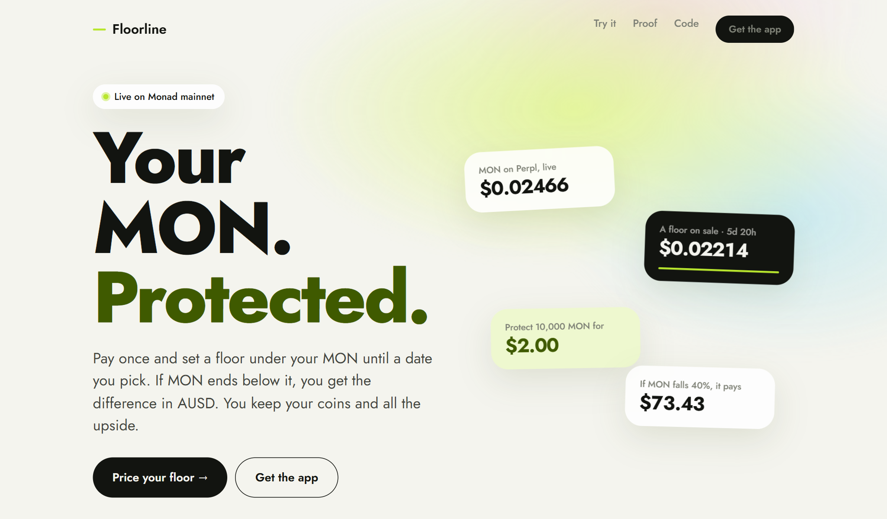
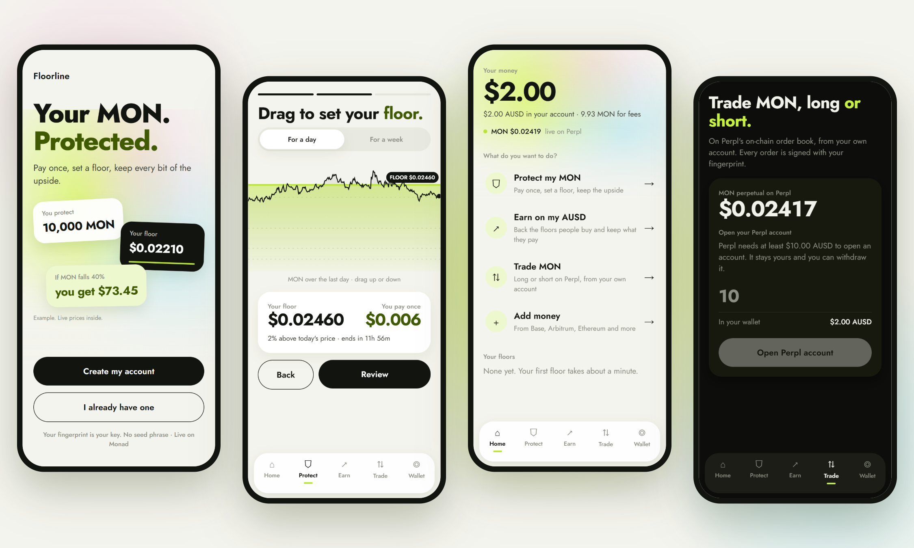
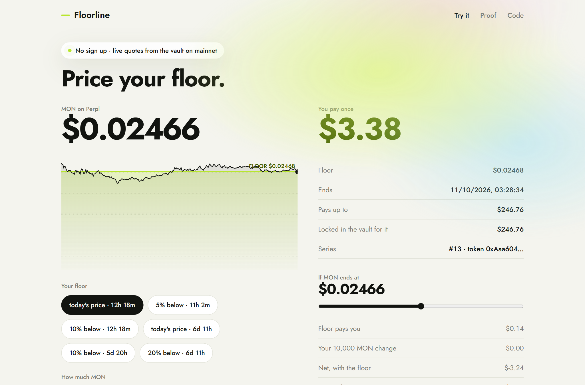
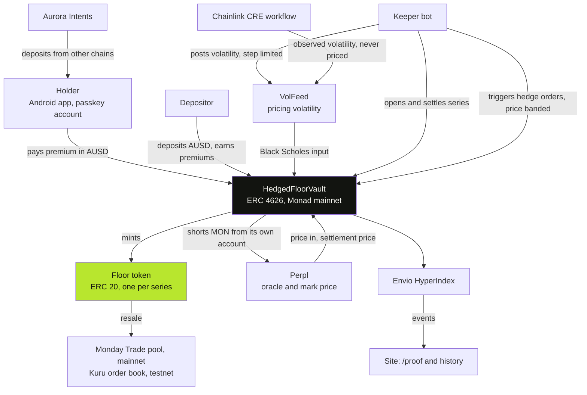

<p align="center">
  
</p>

<h1 align="center">Floorline</h1>

<p align="center">
  <b>Protect your MON without selling it.</b><br>
  Pay once, set a floor under your MON until a date you pick. If MON ends below it you are paid the difference in AUSD, and you keep your coins and all the upside.
</p>

<p align="center">
  <a href="https://floorline-app.vercel.app"></a>
  <a href="https://monadscan.com/address/0x2286f16a97e592D2C90C31e3ae56E3F4A9ec5dB4"></a>
  <a href="https://github.com/jenzylove/floorline/actions/workflows/ci.yml"></a>
  <a href="https://floorline-app.vercel.app/proof"></a>
  
  <a href="LICENSE"></a>
</p>

<p align="center">
  
</p>

Built for **Monad Metropolis 2026**, Track 01: Onchain Finance & Trading. Live on Monad mainnet.

## Start here

| | |
|---|---|
| Live site | https://floorline-app.vercel.app |
| Price a floor, no sign up | https://floorline-app.vercel.app/demo |
| Every transaction, linked | https://floorline-app.vercel.app/proof |
| Android app | https://github.com/jenzylove/floorline/releases/latest/download/floorline.apk |
| The vault on Monad mainnet | [`0x2286…5dB4`](https://monadscan.com/address/0x2286f16a97e592D2C90C31e3ae56E3F4A9ec5dB4) |
| Addresses and deploy hashes | [docs/DEPLOYMENTS.md](docs/DEPLOYMENTS.md) |
| What was built, day by day | [docs/BUILD_LOG.md](docs/BUILD_LOG.md) |
| Security model | [SECURITY.md](SECURITY.md) |

## The problem

A MON holder who fears a drop has two choices today: sell and lose the upside, or short a perp and risk liquidation and funding. There is no simple way on Monad to pay a small known price and be covered.

## What Floorline does

A floor is a fully backed put on MON, settled in AUSD.

1. **You pay once.** Pick a floor and a date. The vault prices it on chain with Black Scholes from MON's realised volatility. The quote is what you pay.
2. **The payout is locked.** The most the floor could ever pay is locked in AUSD inside the vault the moment you buy. Every floor is backed in full, so a payout can never fail for lack of funds.
3. **The vault hedges itself.** It holds its own Perpl account and shorts MON there to offset the risk it carries. A keeper triggers the orders but can only trade through the vault, inside a price band.
4. **It settles on the date.** Seconds after expiry the floor settles at Perpl's oracle price. Below your floor, you collect the difference.

The other side is the vault. Anyone can deposit AUSD (ERC 4626), back the floors and earn the premiums. Depositors can lose part of their deposit when MON falls hard. The hedge softens that. It does not remove it.

Each floor is an ERC 20 token, so it can be resold before the date.

## A new market on Kuru

**Floors trade on Kuru Spot V2.** Kuru's team created the FLOOR/USDC market for Floorline (`0xFD5d4Ad286C43dBFd2B2A1Ce0db82E6EA6f5aa38`, Monad testnet), and it has live quotes and real fills, including trades made from the app on a phone.

A floor is an ERC 20 token, so it can trade on an order book like any other asset. What makes it a market and not just a listed token is a price both ways:

* The vault will always mint a floor at its own quote. That is the ceiling.
* A keeper (`keeper/src/kuru`) reads that quote and keeps a ladder of asks just under it and bids under the floor's value, on Kuru's order book.
* When the vault's price moves, or an order is filled, the keeper cancels and replaces its quotes.

So buying a floor on Kuru is never worse than minting one, and a holder can sell before the end date.

The keeper earns the spread: the vault's mint price is fair value plus 10% (`spreadBps = 1000`), so asks just under it sit about 9% above fair value and bids sit below it. A test asserts both (`keeper/test/kuru.test.ts`).

The live book is on [/proof](https://floorline-app.vercel.app/proof), read from the market contract, and in the app under Trade. Run the maker with `npm run kuru:v2` in `keeper/`.

## The app

<p align="center">
  
</p>

Sign in with a fingerprint, no seed phrase. Add money from another chain, protect MON in three steps by dragging the floor on the chart, earn from the vault, and trade MON on Perpl from the same account. Light and dark.

Under Trade there is also **Floors on Kuru**: the live FLOOR/USDC order book from Kuru Spot V2, and buy or sell from the same passkey account. That part runs on Monad testnet with test USDC and is labelled so in the app.

## Judge fast path

1. Open [/demo](https://floorline-app.vercel.app/demo). Pick a floor and an amount. The price is read from the mainnet vault every 10 seconds. Drag the slider to see the payout at any MON price.
2. Open [/proof](https://floorline-app.vercel.app/proof). Vault actions, settlements, volatility updates and the live Perpl hedge position, each linked to its transaction.
3. Install the [Android app](https://github.com/jenzylove/floorline/releases/latest/download/floorline.apk). Sign in with a fingerprint, add AUSD, protect MON in three steps, trade MON on Perpl.

<p align="center">
  
</p>

## Architecture



```
app/        Expo (React Native) app. Mera passkey account, viem.
web/        Static site: landing, /demo, /proof. Reads the chain directly.
contracts/  Foundry. FloorVault, HedgedFloorVault, VolFeed, PerplPriceSource, CreReceiver.
keeper/     TypeScript bot: hedges on Perpl, posts volatility, opens and settles series.
cre/        Chainlink CRE workflow: observed volatility, and it can settle expired series.
indexer/    Envio HyperIndex config and handlers.
docs/       PRD, plan, build log, deployments, submission checklist.
```

Safety checks in the vault: price freshness, mark against oracle deviation, a settlement window after which only the owner can settle, an emergency settle after one day, a step limit on volatility updates, a slippage bound on hedge orders, and a block on deposits while the valuation is stale.

## Results so far

Three floors with a real buyer have run to their end date on mainnet.

| Cycle | Floor | Buyer paid | Floor paid the holder | Hedge result |
|---|---|---|---|---|
| 1 Oct | 140 MON at $0.032206, 15 minutes | $0.0071 | $0, MON ended above | about −$0.04 |
| 9 Oct | 150 MON at $0.024338, 1 hour | $0.0243 | $0, MON ended above | −$0.0169 |
| **12 Oct** | **108 MON at $0.02916, 1 hour** | **$0.2082** | **$0.2110, MON ended below the floor** | **+$0.0167** |

**The 12 Oct floor paid its holder.** Protection on 108 MON was bought from the app on a phone. MON ended $0.001954 below the floor, the keeper settled 16 seconds after the end date, and the holder collected $0.211032 in AUSD in the app: [buy](https://monadscan.com/tx/0x943911c6164bd3eb5f243cff071cc661c32131ffaf8bb046200ac86d9962789f), [settle](https://monadscan.com/tx/0x30cb6d0cfd724e136cc139b3f7ea938cbb06364cf32a2d3f42cc8fd302d020d5), [collect](https://monadscan.com/tx/0xb381bb343c3365944bcc766565ddc88e28ad43c246dac803e65e2434be26ceef). That floor was listed above MON's price to exercise the payout path.

It was also the first cycle hedged from the vault's own Perpl account. The vault's short earned as MON fell, and depositors finished the hour ahead: $0.2082 in, $0.2110 out, $0.0167 from the hedge. Pricing has used MON's realised volatility since the first cycle. Every hash is in [docs/BUILD_LOG.md](docs/BUILD_LOG.md).

## Why Monad

* **The whole trade lives on one chain.** Perpl's order book and oracle are contracts on Monad, so the vault reads the price, hedges and settles against the same state, with no bridge and no off chain price feed.
* **Fast blocks make expiry exact.** A floor settled 9 seconds after its expiry on mainnet. The hedge can be adjusted every few blocks for cents.
* **Cheap gas keeps a small floor worth buying.** Volatility is reposted and new series are opened around the clock; on a slow, costly chain that upkeep would cost more than the premiums.
* **Room for the math.** On chain Black Scholes makes the vault 27.4 KB, over Ethereum's contract size limit and well inside Monad's 128 KB.
* **AUSD is native.** Premiums, collateral and payouts are one stable asset that the app can also spend on Perpl.

## What is live

On Monad mainnet:

* The vault, on chain pricing, settlement and a rolling menu of floors for a day and a week.
* Floors bought, hedged and settled, including one that paid its holder $0.211 in AUSD.
* The vault hedging itself from its own Perpl account, after 75+ fills through Perpl's trading API.
* A resale of a floor token on a mainnet pool (Monday Trade).
* A deposit from Base through Aurora Intents, converted to AUSD on Monad.
* The Android app: passkey account, AUSD balance, protect, earn, collect, Perpl trades, send and withdraw.

On Monad testnet:

* The FLOOR/USDC market on Kuru Spot V2, created by Kuru's team, with a keeper quoting both sides and trades made from the app.

Scope of this build:

* The vault runs at demo size.
* The Chainlink CRE workflow runs in simulation and records an observed volatility; the keeper sets the pricing input.
* Kuru is on testnet, where Kuru opens new markets.
* The owner and keeper roles, and the review the contracts have had, are set out in [SECURITY.md](SECURITY.md).

## Track and bounties

| | How Floorline uses it |
|---|---|
| Track 01 | A new primitive for Monad: fully backed downside protection, priced, hedged and settled on chain. |
| Agora | Mobile trading app. Passkey sign in, AUSD balance, floors paid and backed in AUSD, Perpl trades in the app. |
| Perpl | Price, settlement oracle and hedge venue. An automated delta hedging bot: 75+ fills through Perpl's trading API, then moved on chain into a Perpl account the vault owns. The bot reads market data and candles from Perpl's API. |
| Chainlink CRE | A workflow that computes MON's realised volatility from Perpl candles and writes it on chain as an independent check on the pricing input. |
| Kuru | Floors as a new asset class on Kuru Spot V2: the vault mints, prices and settles them, and a keeper makes a two sided market in them on the FLOOR/USDC market Kuru's team created (testnet). |
| Aurora Intents | Add money from Base, Arbitrum, Ethereum and more straight into the Monad account. |
| Mera | The whole account layer. A passkey on the phone, no seed phrase, no extension. |
| Envio | HyperIndex indexes every vault and volatility event for the proof page and history. |

## Mainnet addresses (chain 143)

| Contract | Address |
|---|---|
| HedgedFloorVault | `0x2286f16a97e592D2C90C31e3ae56E3F4A9ec5dB4` |
| VolFeed | `0x1820045B9a1366d7a8aB8715cf9607f0C3635c6d` |
| PerplPriceSource | `0x0E21C63a335344Db44938C02170374302e7b0b77` |
| CreReceiver | `0x25541C105A727BFc266509cCdbA1327F2c0a6895` |
| AUSD | `0x00000000eFE302BEAA2b3e6e1b18d08D69a9012a` |
| Perpl exchange | `0x34B6552d57a35a1D042CcAe1951BD1C370112a6F` |

Testnet addresses, the retired v1 and all deploy hashes are in [docs/DEPLOYMENTS.md](docs/DEPLOYMENTS.md).

## Run it

Contracts (needs [Foundry](https://book.getfoundry.sh)):

```sh
git clone --recurse-submodules https://github.com/jenzylove/floorline.git
cd floorline/contracts
forge test --no-match-path "test/fork/*"                                  # 44 unit, fuzz and invariant tests
forge test --fork-url https://rpc.monad.xyz --match-path "test/fork/*"    # 6 tests against live Perpl
```

Keeper:

```sh
cd keeper
npm install
npm test
cp .env.example .env     # fill in the keeper key and vault address
npm start
```

App:

```sh
cd app
npm install
npx expo start
```

Website: static files in `web/`. Serve the folder with any static server.

## Credits

External code: OpenZeppelin Contracts, PRBMath, forge-std, viem, Expo and React Native, the Mera SDK, Envio HyperIndex, the Chainlink CRE SDK, the Kuru SDK, the NEAR Intents 1Click API and the KyberSwap aggregator API. All contracts in `contracts/src` were written for this hackathon.

## AI use

Built with AI coding assistance. Product decisions, on device testing and every mainnet transaction are the author's.

## License

MIT. See [LICENSE](LICENSE).

Not investment advice. Floors can expire worthless.
