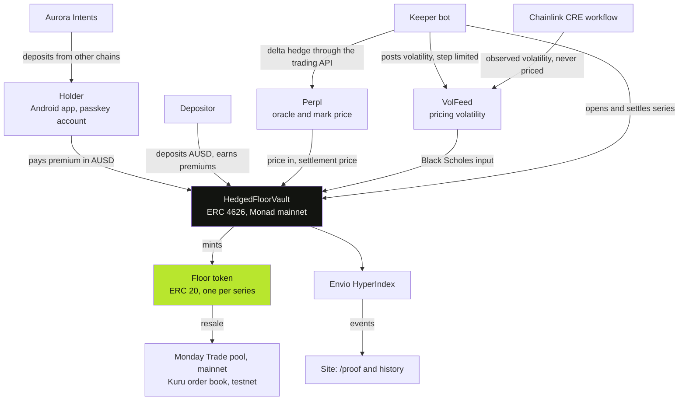

<p align="center">
  
</p>

<h1 align="center">Floorline</h1>

<p align="center">
  <b>Protect your MON without selling it.</b><br>
  Pay once, set a floor under your MON until a date you pick. If MON ends below it you are paid the difference in AUSD, and you keep your coins and all the upside.
</p>

<p align="center">
  <a href="https://floorline-app.vercel.app"></a>
  <a href="https://monadscan.com/address/0x2286f16a97e592D2C90C31e3ae56E3F4A9ec5dB4"></a>
  <a href="https://github.com/jenzylove/floorline/actions/workflows/ci.yml"></a>
  <a href="https://floorline-app.vercel.app/proof"></a>
  
  <a href="LICENSE"></a>
</p>

<p align="center">
  
</p>

Built for **Monad Metropolis 2026**, Track 01: Onchain Finance & Trading. Live on Monad mainnet.

## Start here

| | |
|---|---|
| Live site | https://floorline-app.vercel.app |
| Price a floor, no sign up | https://floorline-app.vercel.app/demo |
| Every transaction, linked | https://floorline-app.vercel.app/proof |
| Android app | https://github.com/jenzylove/floorline/releases/latest/download/floorline.apk |
| The vault on Monad mainnet | [`0x2286…5dB4`](https://monadscan.com/address/0x2286f16a97e592D2C90C31e3ae56E3F4A9ec5dB4) |
| Addresses and deploy hashes | [docs/DEPLOYMENTS.md](docs/DEPLOYMENTS.md) |
| What was built, day by day | [docs/BUILD_LOG.md](docs/BUILD_LOG.md) |
| Security model and known limits | [SECURITY.md](SECURITY.md) |

## The problem

A MON holder who fears a drop has two choices today: sell and lose the upside, or short a perp and risk liquidation and funding. There is no simple way on Monad to pay a small known price and be covered.

## What Floorline does

A floor is a fully backed put on MON, settled in AUSD.

1. **You pay once.** Pick a floor and a date. The vault prices it on chain with Black Scholes from MON's realised volatility. The quote is what you pay.
2. **The payout is locked.** The most the floor could ever pay is locked in AUSD inside the vault the moment you buy. Every floor is backed in full, so a payout can never fail for lack of funds.
3. **The vault hedges.** A keeper shorts MON on Perpl to offset the risk the vault carries.
4. **It settles on the date.** Seconds after expiry the floor settles at Perpl's oracle price. Below your floor, you collect the difference.

The other side is the vault. Anyone can deposit AUSD (ERC 4626), back the floors and earn the premiums. Depositors can lose part of their deposit when MON falls hard. The hedge softens that. It does not remove it.

Each floor is an ERC 20 token, so it can be resold before the date.

## The app

<p align="center">
  
</p>

Sign in with a fingerprint, no seed phrase. Add money from another chain, protect MON in three steps by dragging the floor on the chart, earn from the vault, and trade MON on Perpl from the same account. Light and dark.

## Judge fast path

1. Open [/demo](https://floorline-app.vercel.app/demo). Pick a floor and an amount. The price is read from the mainnet vault every 10 seconds. Drag the slider to see the payout at any MON price.
2. Open [/proof](https://floorline-app.vercel.app/proof). Vault actions, settlements, volatility updates and the live Perpl hedge position, each linked to its transaction.
3. Install the [Android app](https://github.com/jenzylove/floorline/releases/latest/download/floorline.apk). Sign in with a fingerprint, add AUSD, protect MON in three steps, trade MON on Perpl.

<p align="center">
  
</p>

## Architecture



```
app/        Expo (React Native) app. Mera passkey account, viem.
web/        Static site: landing, /demo, /proof. Reads the chain directly.
contracts/  Foundry. FloorVault, HedgedFloorVault, VolFeed, PerplPriceSource, CreReceiver.
keeper/     TypeScript bot: hedges on Perpl, posts volatility, opens and settles series.
cre/        Chainlink CRE workflow: observed volatility, and it can settle expired series.
indexer/    Envio HyperIndex config and handlers.
docs/       PRD, plan, build log, deployments, submission checklist.
```

Safety checks in the vault: price freshness, mark against oracle deviation, a settlement window after which only the owner can settle, an emergency settle after one day, a step limit on volatility updates, a slippage bound on hedge orders, and a block on deposits while the valuation is stale.

## Why Monad

* **The whole trade lives on one chain.** Perpl's order book and oracle are contracts on Monad, so the vault reads the price, hedges and settles against the same state, with no bridge and no off chain price feed.
* **Fast blocks make expiry exact.** A floor settled 9 seconds after its expiry on mainnet. The hedge can be adjusted every few blocks for cents.
* **Cheap gas keeps a small floor worth buying.** Volatility is reposted and new series are opened around the clock; on a slow, costly chain that upkeep would cost more than the premiums.
* **Room for the math.** On chain Black Scholes makes the vault 27.4 KB, over Ethereum's contract size limit and well inside Monad's 128 KB.
* **AUSD is native.** Premiums, collateral and payouts are one stable asset that the app can also spend on Perpl.

## What is real, and what is not

Real, on Monad mainnet:

* Vault, pricing, settlement and the rolling series (a day and a week, three floors each).
* Real floors bought, hedged and settled. One full cycle: 30 hedge orders on Perpl, settled 9 seconds after expiry.
* A real resale of a floor token on Monday Trade.
* A real deposit from Base through Aurora Intents, converted to AUSD on Monad.
* The mobile app: passkey account, AUSD balance, buy, earn, collect, and Perpl trades from the same account.

Limits you should know:

* **Size is small.** The vault holds a few dollars. This is a working product at demo scale, not a funded one.
* **The hedge runs through Perpl's API from the operator's Perpl account,** not from the vault contract. Hedge profit and loss is swept to the vault by the operator after each cycle, and every sweep is logged. The contract can also hedge by itself (`HedgedFloorVault.hedge`), and that path is tested on a mainnet fork, but the live bot uses the API.
* **Chainlink CRE is simulated, not deployed to a DON.** The simulation forwarder does not verify signatures, so CRE reports are recorded as an *observed* volatility for anyone to compare. They never set the price. The keeper posts the pricing volatility, limited to a maximum step per update. The workflow can also settle expired series, but every settlement so far was done by the keeper.
* **Kuru is on testnet.** A floor token trades on a Kuru order book on Monad testnet with real fills. Kuru Spot V2 market creation is owner only, so that listing depends on Kuru's team.
* **The owner key has real power:** it can change pricing parameters, pause buys and settle late. There is no timelock or multisig yet.
* **The keeper is one process.** If it stops, hedging and new series stop. Anyone can still settle an expired series in its window.
* The contracts have had an internal review only. No external audit.

## Track and bounties

| | How Floorline uses it |
|---|---|
| Track 01 | A new primitive for Monad: fully backed downside protection, priced, hedged and settled on chain. |
| Agora | Mobile trading app. Passkey sign in, AUSD balance, floors paid and backed in AUSD, Perpl trades in the app. |
| Perpl | Price, settlement oracle and hedge venue. An automated delta hedging bot on Perpl's trading API. |
| Chainlink CRE | A workflow that computes MON's realised volatility from Perpl candles and writes it on chain as an independent check on the pricing input. |
| Kuru | Floors as a new asset class on Kuru's order book. |
| Aurora Intents | Add money from Base, Arbitrum, Ethereum and more straight into the Monad account. |
| Mera | The whole account layer. A passkey on the phone, no seed phrase, no extension. |
| Envio | HyperIndex indexes every vault and volatility event for the proof page and history. |

## Mainnet addresses (chain 143)

| Contract | Address |
|---|---|
| HedgedFloorVault | `0x2286f16a97e592D2C90C31e3ae56E3F4A9ec5dB4` |
| VolFeed | `0x1820045B9a1366d7a8aB8715cf9607f0C3635c6d` |
| PerplPriceSource | `0x0E21C63a335344Db44938C02170374302e7b0b77` |
| CreReceiver | `0x25541C105A727BFc266509cCdbA1327F2c0a6895` |
| AUSD | `0x00000000eFE302BEAA2b3e6e1b18d08D69a9012a` |
| Perpl exchange | `0x34B6552d57a35a1D042CcAe1951BD1C370112a6F` |

Testnet addresses, the retired v1 and all deploy hashes are in [docs/DEPLOYMENTS.md](docs/DEPLOYMENTS.md).

## Run it

Contracts (needs [Foundry](https://book.getfoundry.sh)):

```sh
git clone --recurse-submodules https://github.com/jenzylove/floorline.git
cd floorline/contracts
forge test --no-match-path "test/fork/*"                                  # 39 unit and invariant tests
forge test --fork-url https://rpc.monad.xyz --match-path "test/fork/*"    # 6 tests against live Perpl
```

Keeper:

```sh
cd keeper
npm install
npm test
cp .env.example .env     # fill in the keeper key and vault address
npm start
```

App:

```sh
cd app
npm install
npx expo start
```

Website: static files in `web/`. Serve the folder with any static server.

## Credits

External code: OpenZeppelin Contracts, PRBMath, forge-std, viem, Expo and React Native, the Mera SDK, Envio HyperIndex, the Chainlink CRE SDK, the Kuru SDK, the NEAR Intents 1Click API and the KyberSwap aggregator API. All contracts in `contracts/src` were written for this hackathon.

## AI use

This project was built with heavy use of an AI coding assistant (Claude Code) for code, tests, review and documentation, directed and checked by the author. All mainnet transactions were signed with the author's keys.

## License

MIT. See [LICENSE](LICENSE).

Not investment advice. Floors can expire worthless.
